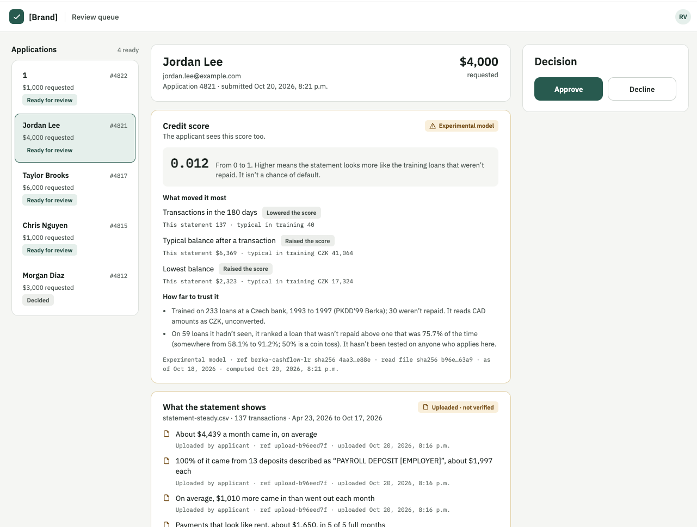
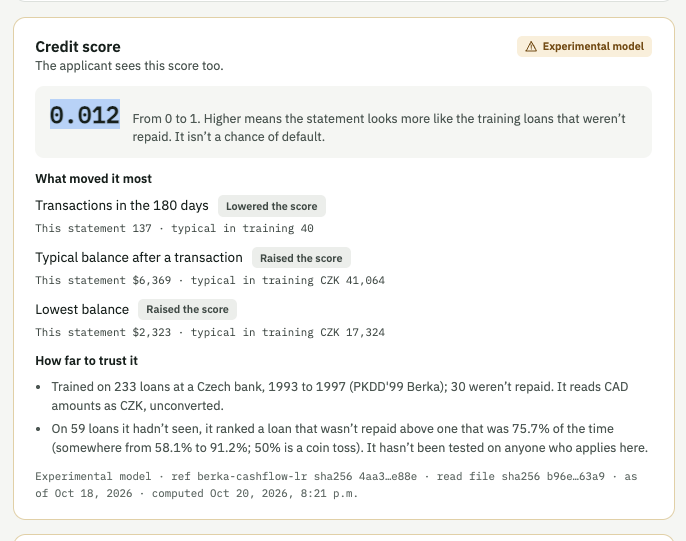
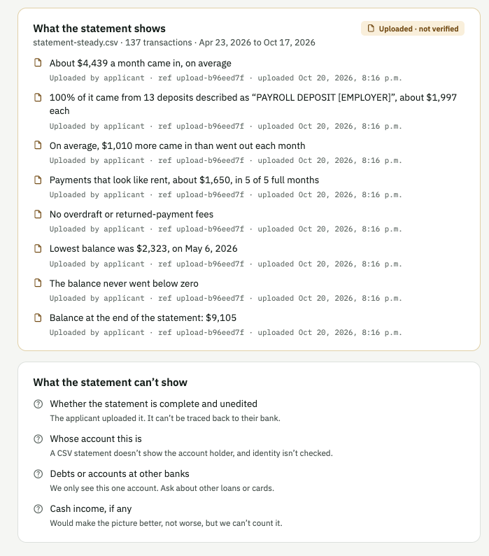
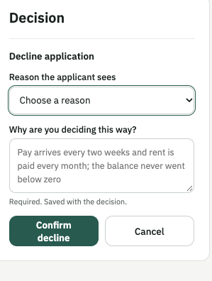

# Baseline CUJ & Audit: Credit Score Assessor (product name)

**Team:** catalyst
**Date of audit:** Oct 21, 2026

## 1. Overview

A borrower applies for a loan and submits their bank statement as a CSV. A private credit associate opens the application in our review system, which shows:

- the borrower's details and requested amount
- a **credit score** from our ML model, with the factors that moved it most
- facts read from the bank statement (income, cash flow, rent, fees)

The associate then **approves or declines** the request.

This document measures that journey on the product **as it is today** (the baseline). After we make changes, we rerun the same journey and compare.

---

## 2. Persona and User Goal

### Persona: Private credit associate at a mid-market private equity firm

| | |
|---|---|
| **Role** | Associate on the private credit (lending) team of a mid-market PE firm |
| **Day to day** | Reviews about 15 borrower applications per week |
| **What they work with** | A queue of applications, each with the borrower's details, their uploaded bank statement, and a model credit score |
| **Constraints** | Tight deadlines. Every approval or decline must be justified. |
| **What they care about** | Deciding quickly, being able to defend the decision, consistency across borrowers |

### User Goal

> Review a borrower's application and make an approve or decline decision they can **defend**, in **under 10 minutes**.

- **Measurable:** end-to-end time of 600 seconds or less
- **Concrete outcome:** a decision submitted, with a reason they can explain

---

## 3. Journey Audit

### Audit setup

- **Tester:** Alice J (name and role, ideally someone not on the dev team)
- **Product version / commit:** [web app code commit](https://github.com/lukezhang01/evidence-lender/commit/0995b5a6ee07e73a7974a67fa043b484038f081b)
- **Test data:** [test csv file](test_data/berka_fake_statement.csv)
- **Start point:** review queue open in the browser
- **End point:** decision submitted
- **How measured:** screen recording + stopwatch, one screenshot per step, saved as `screenshots/step1.png`, `screenshots/step2.png`, and so on

### Friction severity scale

- **None / Great:** completes the step with no confusion
- **Moderate:** hesitates or hits unclear UI, but recovers without help
- **Severe:** abandons the step, needs outside help, or gets clearly frustrated

### Audit table

> Times are our estimates.

| Step # | Action (what the user does) | Context Switches (where the user loses focus or leaves the app) | Time (s) | Friction Severity | Evidence |
|---|---|---|---|---|---|
| 1 | Open the review queue | None | 5 | None |  |
| 2 | Open a borrower's application | None | 10 | None | . |
| 3 | Read the borrower's details and requested amount | None | 20 | None | . |
| 4 | Read the credit score and what moved it most | None | 60 | None |  |
| 5 | Read how far to trust the model | Loses focus on long text about training data and test results | 180 | Moderate |  |
| 6 | Read what the statement shows (income, cash flow, rent, fees) | None | 60 | None |  |
| 7 | Work out what to check and what to do next (no instructions on the page) | Leaves the app to ask a teammate what to do | 240 | Severe | . |
| 8 | Decline the application | None, but reads long text for each decline reason | 150 | Moderate |  |

### Totals

| | Baseline |
|---|---|
| Total time (s) | 725 (about 12 min) |
| Total context switches | 2 (steps 5 and 7) |
| Steps rated Severe | 1 (step 7) |
| Steps rated Moderate | 2 (steps 5 and 8) |
| Completed without outside help? | No (asked a teammate at step 7) |

---

## 4. Highlights and Lowlights

| Severity | Step | Finding | Fix |
|---|---|---|---|
| Severe | 7 | No instructions on what to check or do next | Add a short checklist |
| Moderate | 5 | "How far to trust it" is long and hard to act on | Shorten it, add "View statement" |
| Moderate | 8 | Too many words when declining | One-line decline reasons |
| None (highlight) | 4 | Score shows what moved it, in plain words | Keep |

---

## 5. Product Recommendations

### Recommendation 1: Let the associate view the submitted bank CSV

- **Pain point:** Step 5, 180 seconds, rated Moderate. The associate reads a long note on how far to trust the model, but can't check the borrower's transactions themselves.
- **Technical change:** return the parsed CSV rows with the application, and link each fact to the rows it's based on.
- **Design change:** shorten "How far to trust it" to one line, with a "View statement" button that opens a table of the transactions (date, description, amount, balance). Clicking a fact highlights its rows.
- **Expected impact:** step 5 drops from 180 s to under 60 s. Severity goes from Moderate to None.

### Recommendation 2: Clear next steps and shorter decline text

- **Pain point:** Step 7, 240 seconds, rated Severe (asked a teammate), and step 8, 150 seconds, rated Moderate.
- **Technical change:** build a 3-line summary from data the app already has (score, top risk factor, monthly net cash flow). Shorten each decline reason to one line in the config.
- **Design change:** put the summary and a short checklist at the top (check score, check statement, decide), with the approve and decline buttons right under it. Each decline reason shows one line, with details on click.
- **Expected impact:** step 7 drops from 240 s to under 30 s, Severe to None. Step 8 drops from 150 s to under 60 s, Moderate to None.

---

## 6. Success Metrics

The next iteration passes if every target below is met on the same journey with the same test data.

| Metric | Target (next iteration) | Baseline | How measured |
|---|---|---|---|
| End-to-end task time | 600 s or less | 725 s | Stopwatch from opening the queue (step 1) to decision submitted (step 8) |
| Steps rated Severe | 0 | 1 | Audit table |
| Steps rated Moderate | 1 or fewer | 2 | Audit table |
| Context switches | 0 | 2 | Audit table |
| Completed without outside help | Yes | No | Observation during audit |