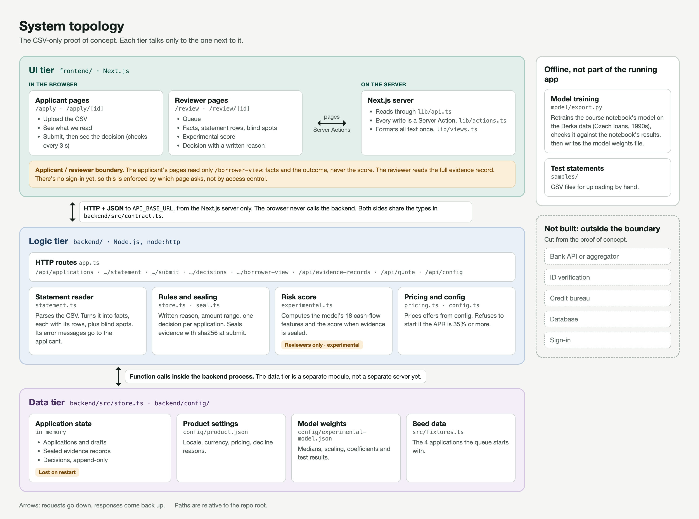

# Proof of Concept: Credit Score Assesor

## 1. What We're Proving

Our bet: a borrower's bank transactions (cash flow) can predict default and drive a lending recommendation. We prove:

1. **Technical feasibility:** a real bank CSV goes in, and a real probability of default (PD), interest rate, and loan amount come out.
2. **Architectural clarity:** separate components with a clear data flow, so credit report data can be added later.
3. **User viability:** a private credit associate can finish the task (see `baseline-cuj.md`).

## 2. Why Cash Flow

- **CFPB (2023):** among people with similar credit scores, those with healthy cash flow were less likely to fall seriously behind on payments.
- **FinRegLab (2019):** cash-flow-only models predicted default about as well as credit scores (AUC 0.59 to 0.73), and combining both did better. So we start with cash flow and add the credit report next.

## 3. Training Data: Berka (PKDD'99)

Real, anonymized Czech bank data: 682 loans (76 defaults) linked to about 1 million transactions. Default = loan status B or D.

- We convert Berka transactions into our own CSV format, so the model only learns from what users upload.
- Features only use transactions from before the loan started.
- With few defaults, we use stratified 5-fold cross-validation.

**Features:** average monthly inflow, outflow, and net cash flow; inflow volatility; share of months with negative cash flow; transactions per month; account history length.

## 4. System Topology



Each component talks to the next through a fixed input and output. Adding the credit report means a new parser and a retrained model, while the frontend and pricing stay the same. Training and the live app share one feature extraction module.

## 5. Pricing Formula (Need optimization in next iteration)

```
rate        = 5% base + PD × 45% (loss if default) + 3% margin
max_payment = avg monthly net cash flow / 1.25
amount      = loan size whose 36-month payment equals max_payment
```

No offer if PD is above 20%. **Example:** a PD of 5% gives a 10.25% rate. With $10,000/month net cash flow, the loan amount is about $247,000.

## 6. Validation Scope

**Primary interaction:** a private credit associate uploads a borrower's bank statement CSV and gets back a PD, a recommended interest rate, and a loan amount.

**"Working" means:**

1. Features are computed from the uploaded file itself. Nothing is mocked or hardcoded.
2. A PD, rate, and amount (or "no offer") appear within 5 seconds.
3. Different files give different results.
4. A malformed CSV shows an error instead of crashing.

| In scope now | Deferred |
|---|---|
| Bank CSV with our exact column names | Auto-mapping other bank formats |
| Logistic regression on cash flow | Credit report features |
| Fixed pricing formula | Calibrated pricing |
| PD, rate, and amount | Reasons behind the PD |

**Accepted constraints and limitations:**

- Only CSVs with our exact column names (4-field or 5-field layout) and at least 3 months of history.
- The credit report upload button works, but the file isn't used yet.
- No reasons are shown for the PD yet, so users can't explain the result.
- The model is trained offline and loaded from a file. Requests run one at a time.
- Berka is a proxy: personal accounts at a 1990s Czech bank, not businesses.
- 76 defaults is a small sample, so AUC will be noisy.
- Pricing parameters are assumptions, not calibrated to real loans.
- Data handling and deployment: [test data](test_data/berka_fake_statement.csv).

## 7. Pass Criteria

| Claim | Pass if | Result |
|---|---|---|
| Technical feasibility | 4 sample bank CSVs go from upload to the review queue with a credit score, with no errors | Pass: 4 of 4. A malformed CSV is rejected with an error. All 50 backend tests pass. |
| Model quality | AUC of 0.60 or higher on loans the model hasn't seen | Pass: 0.757 on 59 unseen Berka loans (could be anywhere from 0.58 to 0.91) |
| Architectural clarity | Diagram matches the running system | Pass: every UI, Logic, and Data module in the diagram exists in the code |
| User viability | A user completes the task, and the CUJ records time, context switches, and friction | Pass: completed in 725 s, with 2 context switches and 1 Severe step (needed a teammate) |

## Sources

- [CFPB (2023): Credit scores only tell part of the story](https://www.consumerfinance.gov/archive/blog/credit-scores-only-tells-part-of-the-story-cashflow-data/)
- [FinRegLab (2019): The Use of Cash-Flow Data in Underwriting Credit](https://finreglab.org/wp-content/uploads/2023/12/FinRegLab_2019-07-25_Research-Report_The-Use-of-Cash-Flow-Data-in-Underwriting-Credit_Empirical-Research-Findings.pdf)
- [Berka / PKDD'99, CTU Relational Learning Repository](https://relational.fel.cvut.cz/)